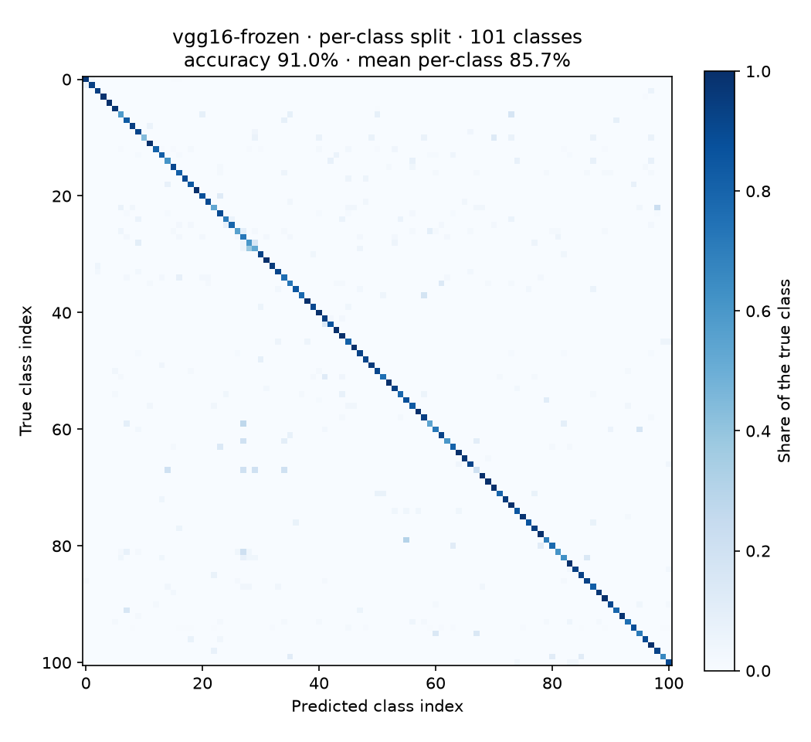

# Caltech-101 image classification: CNN from scratch vs. VGG16 transfer learning

Classifies the 101 object categories of **Caltech-101** with a TensorFlow/Keras CNN in two ways:

- an AlexNet-style network trained from random weights;
- **VGG16 pretrained on ImageNet**, used as a feature extractor.

## Results (VGG16, frozen features)

Produced by the GitHub Actions workflow in this repository (`results/*.json`), seed 42, 224 × 224 input.

| Split | Train / val / test images | Accuracy | Mean per-class accuracy |
|---|---|---|---|
| 30 training images per class (standard protocol) | 2,575 / 455 / 5,647 | 91.0% | 85.7% |
| Stratified 70% / 30% | 5,162 / 911 / 2,604 | 90.3% | 85.0% |



**How to read the two metrics.** Class sizes are very unequal: about 40 to 800 images per class,
according to the dataset card. Overall accuracy is dominated by a few large classes, so the standard Caltech-101 measure is the **mean per-class
accuracy**. It is about 5 points lower than overall accuracy here.

**More training data barely helps.** The ratio split has about twice as many training images as
the 30-per-class split, yet both give about the same result. A likely explanation (not tested here)
is that with frozen ImageNet features the features, not the number of examples, limit performance;
fine-tuning would test this. The two splits also use different test sets, so the comparison is
approximate.

These are single runs with one seed, so no confidence interval is given. Differences of under one
point between the two splits should not be read as meaningful.

**AlexNet from scratch** is implemented (`--model alexnet`) but not run in CI: training it on
CPU-only GitHub runners is impractical. Run it on a GPU (e.g. Google Colab) to compare. No AlexNet
number is reported here.

## Method

- **Preprocessing.** `vgg16.preprocess_input` (RGB→BGR and ImageNet mean subtraction), the
  preprocessing VGG16 was trained with.
- **Frozen features.** VGG16 convolutional layers with global average pooling (512 features per
  image). The features are computed once. Only a small head is trained on them:
  Dense 256 → Dropout 0.5 → softmax.
- **Fine-tuning (optional).** `--model vgg16-finetune` then also trains the last convolutional block
  (`block5`) together with the head, at learning rate 1e-5.
- **Validation.** 15% of the training images are held out for early stopping (patience 5). The
  test set is used once, at the end.
- **Classes.** The `BACKGROUND_Google` clutter folder is not an object category and is excluded.

## Run it

```bash
pip install -r requirements.txt
python train.py --model vgg16-frozen --split per-class        # downloads Caltech-101 on first run
python train.py --model vgg16-frozen --split ratio
python train.py --model vgg16-finetune --split per-class      # GPU recommended
python train.py --model alexnet --split ratio --epochs 30     # GPU needed in practice
python -m pytest -q tests
```

Each run writes `results/<model>_<split>_<n>classes.json` and a normalised confusion matrix.

## Data

Li, F.-F., Andreeto, M., Ranzato, M. A., & Perona, P. (2022). *Caltech 101* [Data set].
CaltechDATA. <https://doi.org/10.22002/D1.20086>
